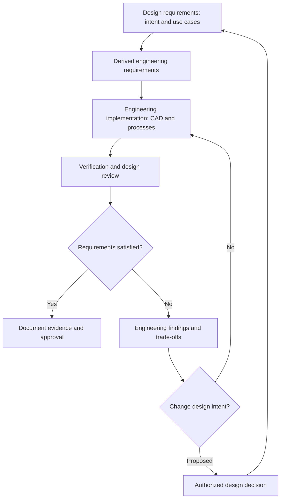

# Architectural Principle 1 — Design-Led Engineering

**Status:** Proposed for review  
**Scope:** FreeCAD Engineering Toolkit, including the Journal Manager

## Principle

Design requirements establish the intended form, function, usability, and experience of a product. Engineering requirements are derived from those objectives and define the technical conditions necessary to realize them.

Engineering analysis, manufacturing constraints, and validation results provide feedback into an iterative design process. When conflicts arise, they are resolved through documented design decisions rather than implicit changes to design intent.

## Requirement domains

- **Design:** aesthetics/style, ergonomics/human interaction, functional requirements/use cases, usability.
- **Engineering:** structural/mechanical, materials/thermal, manufacturing/assembly, integration/interfaces, safety/reliability.

Categories are extensible and project-specific.

## Traceability and authority

1. Each engineering requirement should link to one or more motivating design requirements, where applicable.
2. A design requirement can generate multiple engineering requirements; an engineering requirement may support multiple design requirements.
3. Implementation artifacts (CAD models, manufacturing definitions, analyses) and verification evidence link back to requirements.
4. Engineering findings can propose revisions to design intent but **cannot automatically approve or change** design requirements.
5. AI agents may propose requirements, trade-offs, and decisions; approval is a separate authorized action.
6. Decisions preserve rationale, alternatives, evidence, affected requirements, and authority.
7. Historical records are append-only; corrections, status changes, and supersessions are linked new events.

## Iterative workflow

1. Establish and approve design intent.
2. Derive engineering requirements.
3. Develop and evaluate implementation alternatives.
4. Verify engineering requirements and review design requirements using appropriate methods.
5. Record conflicts and trade-offs, including evidence and recommendations.
6. Seek authorized decisions when design intent must change; retain the original history.
7. Iterate until requirements are addressed and the appropriate reviews are complete.

A successful analysis does not itself imply design approval.

## Workflow diagram

The following diagram is rendered directly by GitHub from Mermaid source. Its editable standalone source is in [design-led-workflow.mmd](diagrams/design-led-workflow.mmd).

## Implementation implications (not yet implemented)

The Journal Manager will need a requirements register with stable identifiers, typed relationships, revision/status history, explicit decision and approval records, and traceable evidence. Preserve compatibility with the existing event schema until a reviewed migration plan is approved.
