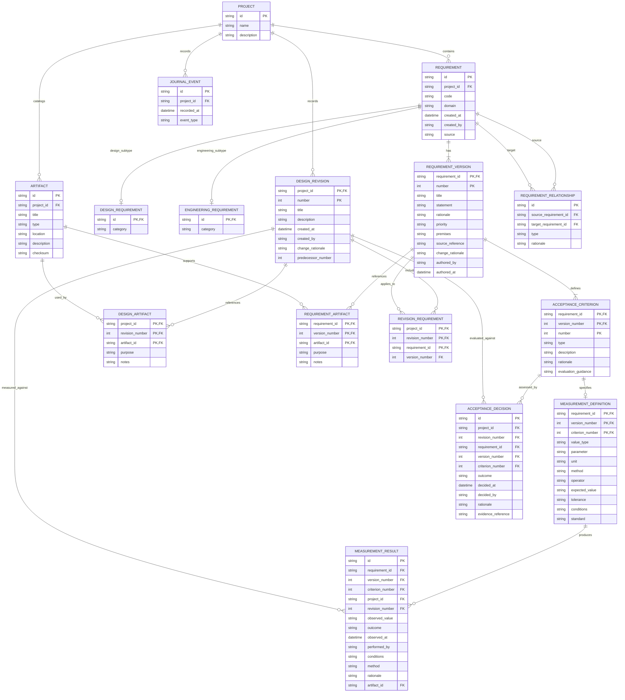

# FreeCAD Engineering Toolkit — Release 1 Logical Data Model

**Status:** Review draft — proposed for repository review  
**Scope:** Small-scale collaboration by one or two humans and a small number of AI agents  
**Updated:** 2026-11-20

## 1. Purpose and modeling principles

The toolkit supports design-led engineering in FreeCAD. Design requirements establish design intent; engineering requirements express verifiable obligations derived from or related to that intent. AI agents may help formulate requirements, inspect CAD states, perform measurements, and propose changes. The model emphasizes traceability and simplicity rather than enterprise-scale workflow administration.

The model uses **fundamental**, **attributive**, **associative**, and **subtype** entities. Attributes do not repeat their entity name unnecessarily (for example, `Design_Requirement.category`). Recorded versions, revisions, results, and decisions are immutable; subsequent changes create new records. Working FreeCAD saves do **not** automatically create Design Revisions.

**Important scope boundary:** This draft records agreed concepts and flags unresolved details. It does not introduce hypotheses, multi-agent coordination, or autonomous exploration entities in Release 1.

## 2. Integrated logical ER diagram

**Diagram conventions and limitations:** Mermaid cannot fully express total/disjoint subtype constraints, conditional participation, or composite FK groupings. The pair (`Measurement_Result.project_id`, `revision_number`) references `Design_Revision`; the triple (`requirement_id`, `version_number`, `criterion_number`) references `Measurement_Definition`. The optional `Measurement_Result.artifact_id` references the independent `Artifact.id`. `Requirement_Relationship` is identity-scoped only. `Journal_Event` remains a skeletal representation pending reconciliation with the existing journal implementation.

## 3. Entity dictionary

Notation: **PK** = primary key; **FK** = foreign key; **R** = required; **O** = optional; **C** = conditionally required. Unless otherwise noted, an entity's recorded values are immutable.

### 3.1 Project — fundamental

| Attribute | Rule | Meaning |
|---|---|---|
| `id` | PK, R | Stable project identity |
| `name` | R (proposed) | Project name |
| `description` | O (proposed) | Project summary |

Project attributes have not yet been individually reviewed; the above is a minimal provisional definition.

### 3.2 Requirement — fundamental supertype

| Attribute | Rule | Meaning |
|---|---|---|
| `id` | PK, R | Stable identity |
| `project_id` | FK, R | Owning Project |
| `code` | R, unique within project | Human-readable identifier |
| `domain` | R | `Design` or `Engineering` |
| `created_at` | R | Origin timestamp |
| `created_by` | R | Originating human or agent |
| `source` | O | Original source of the requirement; name retained by agreement |

`Requirement` specialization into `Design_Requirement` and `Engineering_Requirement` is **total and disjoint**. Identity, domain, and classification do not change between versions.

### 3.3 Design_Requirement — subtype

| Attribute | Rule | Meaning |
|---|---|---|
| `id` | PK/FK, R | Inherited Requirement identity |
| `category` | R, immutable | One of initial categories: `Aesthetics`, `Ergonomics`, `Functionality`, `Usability` |

Category vocabulary is extensible. Changing category requires a **new Requirement**, not a new version.

### 3.4 Engineering_Requirement — subtype

| Attribute | Rule | Meaning |
|---|---|---|
| `id` | PK/FK, R | Inherited Requirement identity |
| `category` | R, immutable | Engineering classification, e.g. Structural, Thermal, Materials, Manufacturing, Integration, Safety; vocabulary not finalized |

Changing category requires a new Requirement.

### 3.5 Requirement_Version — attributive to Requirement

**PK:** (`requirement_id`, `number`). Each Requirement has one or more versions.

| Attribute | Rule | Meaning |
|---|---|---|
| `requirement_id` | PK/FK, R | Parent Requirement |
| `number` | PK, R | Version sequence |
| `title` | R | Short description |
| `statement` | O | Detailed requirement statement |
| `rationale` | O | Why requirement exists |
| `priority` | R | `Mandatory`, `Preferred`, `Optional` |
| `premises` | O | Free-form context, assumptions, and constraints |
| `source_reference` | O | Version-specific supporting reference; name retained by agreement |
| `change_rationale` | C | Required for versions after first |
| `authored_by` | R | Human or agent author |
| `authored_at` | R | Authorship timestamp |

`objective` was deliberately removed as redundant with `statement`. `context`, `assumptions`, and `constraints` were deliberately consolidated into `premises`. The existence of a recorded Requirement Version constitutes its approval; there is **no separate Requirement_Approval entity** in Release 1.

### 3.6 Acceptance_Criterion — attributive to Requirement_Version

**PK:** (`requirement_id`, `version_number`, `number`). Each Requirement Version has **at least one** criterion. All criteria for a requirement must be satisfied for that requirement to be accepted.

| Attribute | Rule | Meaning |
|---|---|---|
| `requirement_id` | PK/FK, R | Parent Requirement |
| `version_number` | PK/FK, R | Parent Requirement Version |
| `number` | PK, R | Criterion number within version |
| `type` | R | `Human_Judgment` or `Measurable` |
| `description` | O | Optional acceptance condition text |
| `rationale` | O | Reason for criterion |
| `evaluation_guidance` | O | Review guidance |

A Design Requirement Version has at least one `Human_Judgment` criterion and may have measurable criteria. Every Engineering Requirement criterion is `Measurable`; an initial criterion is automatically created when an Engineering Requirement is created. `type` is mandatory even when `description` is absent.

### 3.7 Measurement_Definition — attributive to Acceptance_Criterion

**PK and FK:** (`requirement_id`, `version_number`, `criterion_number`). At most one per Acceptance Criterion; required for `Measurable` criteria and not used for `Human_Judgment` criteria.

| Attribute | Rule | Meaning |
|---|---|---|
| `requirement_id` | PK/FK, R | Parent Requirement |
| `version_number` | PK/FK, R | Parent version |
| `criterion_number` | PK/FK, R | Parent criterion |
| `value_type` | R | `Boolean`, `Integer`, `Decimal`, `Categorical` |
| `parameter` | O | Property measured |
| `unit` | O | Measurement unit, if applicable |
| `method` | O | Intended method |
| `operator` | O | Comparison operator |
| `expected_value` | O | Target or limit |
| `tolerance` | O | Permitted deviation |
| `conditions` | O | Intended test conditions |
| `standard` | O | Applicable test standard |

**Progressive definition:** A definition may initially contain only `value_type`. A later Requirement Version is required to refine an immutable definition. Initial operator vocabulary: Equals, NotEquals, LessThan, LessThanOrEqual, GreaterThan, GreaterThanOrEqual, WithinRange. Range representation and typed storage remain to be finalized.

### 3.8 Measurement_Result — fundamental

**PK:** `id`. Each result references exactly one Measurement Definition and one Design Revision. Repeated observations produce new records.

| Attribute | Rule | Meaning |
|---|---|---|
| `id` | PK, R | Independent result identifier |
| `requirement_id`, `version_number`, `criterion_number` | Composite FK, R | Measurement Definition |
| `project_id`, `revision_number` | Composite FK, R | Evaluated Design Revision (normalized representation) |
| `observed_value` | C | Actual value; required for Pass/Fail, optional for Inconclusive |
| `outcome` | R | `Pass`, `Fail`, `Inconclusive` |
| `observed_at` | R | Observation time |
| `performed_by` | R | Human, agent, or process |
| `conditions` | O | Actual test conditions |
| `method` | O | Method actually used |
| `rationale` | O | Evaluation explanation |
| `artifact_id` | O, FK (proposed) | One supporting Artifact, local or remote, when available |

A result's observed value must conform to its definition's `value_type`. The optional `artifact_id` is now a simple FK to the fundamental `Artifact` entity, which can represent local or remote evidence. Multiple supporting artifacts per result are not modeled in Release 1; this is a provisional limitation for review.

### 3.9 Design_Revision — attributive to Project

**PK:** (`project_id`, `number`). Explicitly created immutable snapshot of the **complete** design, not an individual component or every FreeCAD save.

| Attribute | Rule | Meaning |
|---|---|---|
| `project_id` | PK/FK, R | Parent Project |
| `number` | PK, R | Revision number within project |
| `title` | R | Revision label |
| `description` | O | Summary |
| `created_at` | R | Snapshot time |
| `created_by` | R | Human or agent recording snapshot |
| `change_rationale` | O | Reason for revision |
| `predecessor_number` | O | Parent revision in same project |

Branching is supported: multiple revisions may share the same predecessor. Multi-parent merges are outside the present model. Creation of a revision does not imply its acceptance.

### 3.10 Artifact — fundamental

**PK:** `id`. An Artifact is an identifiable information resource (CAD file, drawing, conceptual diagram, report, specification, or other project material). It may be stored in a revision folder, in a shared project folder, or at a remote URL. It is not owned by a particular Design Revision or Requirement Version.

| Attribute | Rule | Meaning |
|---|---|---|
| `id` | PK, R | Stable artifact identity |
| `project_id` | FK, R | Project cataloging the artifact |
| `title` | R | Human-readable name |
| `type` | O | CAD model, drawing, diagram, report, specification, etc. |
| `location` | R | Relative local path or remote URL |
| `description` | O | Additional description |
| `checksum` | O | SHA-256 digest when content is accessible and verifiable |

A local file in a revision folder may be represented as an Artifact associated with that revision. Shared contextual files and remote manufacturer drawings are represented once and linked wherever relevant. A remote URL does **not** guarantee immutable content; a checksum, when available, helps detect changes. The folder-per-revision practice remains, but no longer defines Artifact identity.

### 3.10a Design_Artifact — associative

**PK:** (`project_id`, `revision_number`, `artifact_id`). Connects a Design Revision to an Artifact; an Artifact may support multiple revisions.

| Attribute | Rule | Meaning |
|---|---|---|
| `project_id`, `revision_number` | PK/composite FK, R | Design Revision |
| `artifact_id` | PK/FK, R | Associated Artifact |
| `purpose` | O | Why the artifact is relevant to this revision |
| `notes` | O | Additional association-specific information |

### 3.10b Requirement_Artifact — associative

**PK:** (`requirement_id`, `version_number`, `artifact_id`). Connects a Requirement Version to an Artifact; an Artifact may support multiple versions.

| Attribute | Rule | Meaning |
|---|---|---|
| `requirement_id`, `version_number` | PK/composite FK, R | Requirement Version |
| `artifact_id` | PK/FK, R | Associated Artifact |
| `purpose` | O | Why the artifact is relevant to this requirement version |
| `notes` | O | Additional association-specific information |

`purpose` and `notes` are optional free-form text; no new controlled vocabulary is required. These associations replace the former `Design_Revision.references` attribute and the former Design_Revision-to-Artifact ownership relationship.

### 3.11 Revision_Requirement — associative

**PK:** (`project_id`, `revision_number`, `requirement_id`). Links each Design Revision to exactly one version of each selected Requirement.

| Attribute | Rule | Meaning |
|---|---|---|
| `project_id`, `revision_number` | PK/composite FK, R | Design Revision |
| `requirement_id` | PK/FK, R | Selected Requirement |
| `version_number` | Composite FK, R | Selected Requirement Version |

No `disposition`, cancellation flag, rationale, or authorization attributes. When a revision is explicitly created, the human/agent-assisted procedure chooses the applicable Requirement Versions, optionally starting from the predecessor's selection. **Omission means not applicable to that revision**; different branches can include different requirement sets. Associations are immutable after recording the revision.

### 3.12 Acceptance_Decision — fundamental

**PK:** `id`. Records the determination that an Acceptance Criterion is or is not satisfied for a particular Design Revision, in either Design or Engineering domain.

| Attribute | Rule | Meaning |
|---|---|---|
| `id` | PK, R | Independent decision identifier |
| `project_id`, `revision_number` | Composite FK, R | Evaluated Design Revision |
| `requirement_id`, `version_number`, `criterion_number` | Composite FK, R | Evaluated Acceptance Criterion |
| `outcome` | R | `Accepted`, `Not_Accepted`, `Inconclusive` |
| `decided_at` | R | Decision timestamp |
| `decided_by` | R | Human or automated process |
| `rationale` | O | Explanation |
| `evidence_reference` | O | Supporting reference |

Decisions are append-only. `Human_Judgment` criteria require authorized human decisions; measurable criteria may be decided automatically when evidence is conclusive. An Acceptance Decision must concern a criterion of a Requirement Version actually included in the evaluated revision's `Revision_Requirement` set. No separate `Requirement_Approval`, `Design_Change_Authorization`, `Alternative_Selection`, or Decision supertype in Release 1.

### 3.13 Requirement_Relationship — associative

**PK:** `id`. Links two **Requirement identities**, not specific versions. A relationship persists as requirements acquire new versions; relevance after a revision is reviewed procedurally.

| Attribute | Rule | Meaning |
|---|---|---|
| `id` | PK, R | Independent relationship identity |
| `source_requirement_id` | FK, R | Source Requirement |
| `target_requirement_id` | FK, R | Target Requirement |
| `type` | R | `decomposes_into`, `derives`, `depends_on`, or `conflicts_with` |
| `rationale` | O | Explanation of the relationship |

`decomposes_into` and `derives` are directional; `derives` links Design to Engineering. `conflicts_with` is symmetric and should not be duplicated with reversed endpoints. `decomposes_into` must not form cycles. Version-scoped relationships and a `scope` attribute are **excluded from Release 1** by agreement.

### 3.14 Journal_Event — existing integration (not redesigned here)

The existing Engineering Journal is an append-only history of activities. Release 1 should integrate with its actual implementation rather than inventing a replacement schema. The diagram's `Journal_Event` attributes are placeholders only. Revision creation, measurements, and acceptance decisions should be traceable to relevant journal activity where feasible, without duplicating structured measurement/decision facts.

## 4. Derived acceptance logic

For a Design Revision:

1. Read its explicit `Revision_Requirement` associations; these define the applicable Requirement Versions.
2. For each included Requirement Version, obtain its Acceptance Criteria.
3. For each criterion, find the **latest applicable** `Acceptance_Decision` for the same Design Revision and criterion. Missing decisions mean unresolved, not accepted.
4. A Requirement Version is satisfied only if **all** its criteria have latest outcomes of `Accepted`.
5. A Design Revision satisfies the mandatory acceptance gate when all included **Mandatory** Requirement Versions are satisfied. Preferred and Optional requirements can remain unmet; their status should still be reported.

`Superseded` is **not** an Acceptance Decision outcome. A Requirement Version excluded from a revision is simply absent from its `Revision_Requirement` set; there is no cancellation record. Results and decisions for prior revisions remain historically intact.

**Pending clarification:** The 'latest' decision needs a deterministic ordering (for example `decided_at` plus `id` as tie-breaker, or a monotonic event sequence). Also, whether the model should distinguish the mandatory gate from a separate explicit human sign-off of the *whole revision* has not been agreed; no such entity is introduced here.

## 5. Consolidated business rules

1. A Requirement belongs to one Project, has one immutable domain, and is exactly one of the two subtypes.
2. Each subtype has one mandatory immutable `category`; recategorization creates a new Requirement.
3. Requirement Versions are immutable, sequential, and considered approved by virtue of being recorded.
4. Every Requirement Version has at least one Acceptance Criterion. Engineering criteria are measurable; Design versions have at least one human-judgment criterion.
5. Every measurable criterion has exactly one Measurement Definition. Progressive/incomplete definitions are permitted.
6. Measurements are append-only and reference an exact definition and Design Revision; Pass/Fail require an observed value.
7. Design Revisions are explicitly captured complete-design snapshots; ordinary FreeCAD saves do not create them.
8. Artifacts are fundamental project resources, stored locally or remotely; `Design_Artifact` and `Requirement_Artifact` record their many-to-many associations, with optional purpose and notes. Local revision folders remain the operational convention.
9. Revision_Requirement associations are selected procedurally at revision creation and remain fixed. Omitted requirements do not apply to that revision.
10. Acceptance Decisions are append-only and scoped to a Design Revision and an applicable criterion. Human judgment requires a human; conclusive measurable evaluation may be automatic.
11. Overall mandatory acceptance is **derived**, not stored redundantly.
12. Requirement relationships are identity-scoped only; no version-scoped relationship attributes in Release 1.
13. No alternative-selection model, requirement-approval decision subtype, change-authorization subtype, cancellation workflow, or autonomous agent orchestration in Release 1.

## 6. Items for review before implementation

These are not objections to the agreed conceptual model; they are details that remain open or require consistency checks.

| Item | Question / risk | Suggested handling |
|---|---|---|
| **Project dictionary** | Minimal Project attributes have not been reviewed | Confirm when completing the dictionary |
| **Evidence reference** | A Measurement Result currently references at most one Artifact; a decision also has free-form `evidence_reference` | Confirm whether this is sufficient for Release 1 |
| **Decision order** | Timestamp ties may make “latest” ambiguous | Use deterministic ordering |
| **Revision/criterion consistency** | An Acceptance Decision must refer to a criterion included in the revision's applicable Requirement Version set | Enforce through application validation or suitable composite constraints |
| **Value representation** | `observed_value` and `expected_value` support several types | Define typed storage and validation in implementation design |
| **Range tests** | `WithinRange` requires lower/upper limits | Specify representation when designing schemas |
| **Journal integration** | Existing event schema has not been reproduced in this draft | Reconcile against repository implementation |
| **Approval semantics** | Existence of Requirement Version is approval; authorship can be human or agent | Confirm any human authorization requirements procedurally, without adding an entity |
| **Revision numbering/branching** | One predecessor supports forks but not merges | Keep one predecessor in Release 1 |
| **Artifact minimum** | A revision may have zero linked Artifacts in the current cardinality | Decide whether a complete recorded revision must link at least one CAD file |
| **Artifact location integrity** | External URLs can change, and local paths may be relocated | Use optional checksums and a consistent project-relative path convention |

## 7. Explicitly deferred beyond Release 1

- Normalized Design Premise entity and its many-to-many relationships.
- Hypothesis-driven reasoning and engineering findings as separate entities.
- Multi-agent activity and coordination models.
- Explicit alternative-selection model and multi-parent design merges.
- Enterprise-grade requirement cancellation/waiver authorization and audit workflows.
- Artifact version history, content archival of remote URLs, and generalized multi-artifact evidence bundles.

---

**Review note:** This is a discussion-derived logical model for review, not a statement that all attributes and keys are final. In particular, the journal integration and provisional evidence-reference conventions should be checked against the existing repository before a GitHub PR is opened.